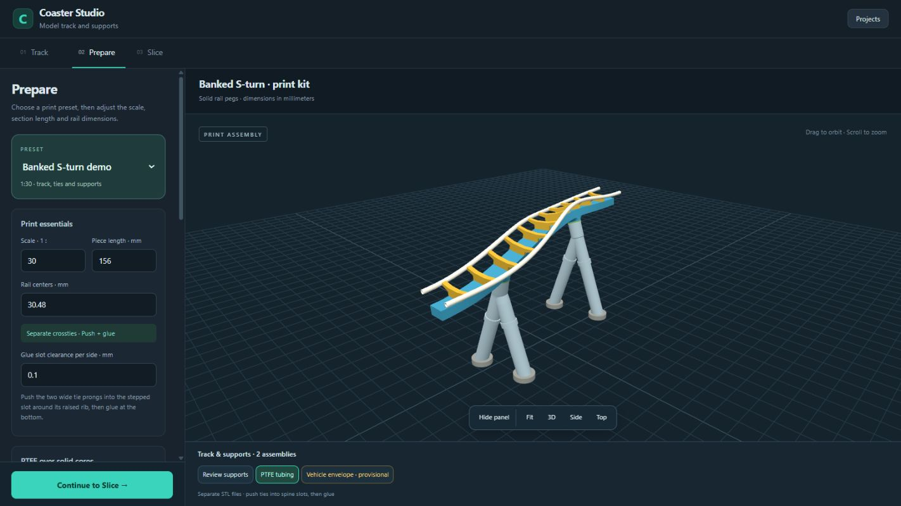
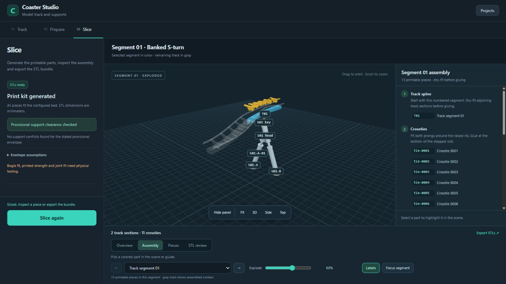

# Coaster Studio

Coaster Studio turns NoLimits 2 track splines into model roller-coaster parts you can print. Import a track CSV, choose your scale and rail dimensions, generate supports, and inspect the numbered pieces before exporting them to your slicer.

**[Download Coaster Studio for Windows](https://github.com/rpowergso/Coaster-Studio/releases/latest)**

## Try the included track

1. Extract the download into Documents or another writable folder. Install [Python 3.13 for Windows (64-bit)](https://www.python.org/downloads/windows/) if it isn't already installed.
2. Run **Launch Coaster Studio.cmd**. The first launch downloads the CAD libraries and opens the local app in your browser.
3. In **Track**, click **Load example** to open the Banked S-turn. It has two track sections and shows how banking, crossties and supports fit together.
4. In **Prepare**, review the print preset and dimensions. In **Slice**, generate the kit. Open **Assembly**, choose a segment, and move the **Explode** slider. Use **Export STLs** to download the kit.
5. Import the STLs into PrusaSlicer, OrcaSlicer, or your preferred slicer.

## Bring your own track

Export a **Center of Rails** spline CSV from NoLimits 2 Professional, then open it in **Track**. Use **Prepare** to adjust the scale, segment length, PTFE dimensions, and joint clearances. The included example needs no NoLimits 2 installation or ride recording.

The app runs locally. The Windows build is unsigned. Fit and clearance checks use a provisional vehicle envelope. Verify joints and clearance on a physical sample before printing a full layout. Coaster Studio exports STL geometry for a separate print slicer.

This repository hosts Coaster Studio releases and issue reports. The application is distributed as a Windows build. Third-party components retain their own licenses.
